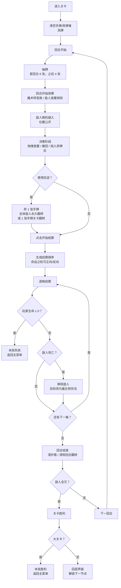
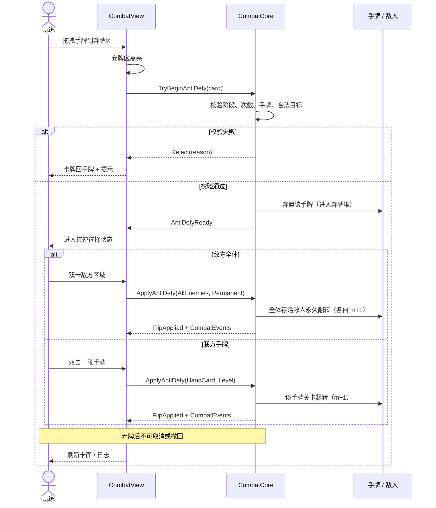

# 技术设计

> 配套文档：`策划案_v0.1.md`（规则）、`MVP构建.md`（范围与验收）、`卡牌效果表.md`（效果原语与逐牌映射）。
> 本文只记录 MVP 的架构决策，不重复规则细节。

## 1. 分层与目录

| 层 | 程序集 | 职责 | 依赖 |
|---|---|---|---|
| 规则核心 | `Tarot.Core` | 牌、牌堆、序列、战斗、结算、效果、随机、事件 | 不引用 UnityEngine |
| 表现层 | `Tarot.Game` | ScriptableObject 数据、场景流、拖拽、UI、日志 | Core |
| 编辑器 | `Tarot.Editor` | 数据校验、跳关、指定手牌等调试工具 | Core、Game |

建议目录：

```text
Assets/Scripts/
  Core/                Tarot.Core.asmdef（noEngineReferences）
    Cards/  Combat/  Deck/  Effects/  Random/
  Game/                Tarot.Game.asmdef
    Data/  Flow/  UI/  View/
  Editor/              Tarot.Editor.asmdef
Assets/Tests/EditMode/ Tarot.Core.Tests.asmdef
```

三条硬规则：

1. Core 不引用 UnityEngine，规则可以脱离场景跑单测。
2. Game 不写战斗规则，只做数据转换、输入、显示。
3. 数据从 ScriptableObject 转成 Core 的普通模型后再进入战斗。

## 2. 核心类型

| 类型 | 职责 | 关键字段 |
|---|---|---|
| `CardDefinition` | 静态牌面 | Id、Arcana、Suit、Rank、UprightEffects、ReversedEffects、IsImplemented |
| `CardInstance` | 战斗中的一张牌 | Definition、Owner、BaseReversed、TurnFlip、LevelFlip、FlipCount(m)、Zone、Transform |
| `DeckState` | 取牌堆/手牌/弃牌堆 | DrawPile、Hand、Discard、Rng；Draw、Discard、Reshuffle、ResetForLevel |
| `SequenceState` | 命运序列 | 9 个 Slot（Occupant、IsVoid）；Place、ReturnToHand、RemoveDead、InsertEnemies |
| `CombatantState` | 玩家/敌人的生命状态 | MaxHp、Hp、Shield |
| `EnemyState` | 一个敌人 | CardInstance、CombatantState、PlacementRule |
| `CombatState` | 单场战斗 | Player、Enemies、Deck、Sequence、Turn、Direction、PendingBuffs、Phase |
| `LayerState` | 一层的进度 | NodeIndex、Cleared |
| `RunState` | 一局 | Hp、Deck（牌 Id 列表）、CardStates（BaseReversed、m）、LayerIndex、Seed |
| `EffectContext` | 效果执行上下文 | Source、Target、CombatState、IRandom |
| `CombatEvent` | 核心到表现层的事件 | 类型 + 数据（伤害、治疗、翻转、抽牌、死亡等） |

`CardInstance.Zone`：Draw / Hand / Discard / Sequence / Removed。

`m` 和永久翻转是整局状态，不能随关卡重建丢失：`RunState.CardStates` 按 `CardId` 保存 `BaseReversed` 与 `m`；关卡开始时恢复到 `CardInstance`，关卡结束时写回。本期牌组无重复，若后续允许重复，改为按牌实例 Id 存储。

## 3. 回合与结算



顺序约定：

1. **回合开始**：抽牌 → 处理回合开始效果（魔术师变换）→ 敌人插入。
2. **决策阶段**：放置、撤回、拖入弃牌区、抗逆都在这里；没有“填满自动结算”。
3. **结算阶段**：先收集本回合的全局修正（愚者跳过首尾、命运之轮方向），再生成结算顺序，逐格执行。
4. 每格执行完立刻检查：玩家死亡（立即失败）、敌人死亡（移除并重定向）。
5. **回合结束**：清空护盾、清除回合翻转；敌人未全灭则下一回合。
6. 所有状态修改只发生在 Core；Game 只消费 `CombatEvent`，不反向改状态。

### 抗逆流程



规则：

- 入口只有“拖拽手牌到弃牌区”，点击弃牌区不触发。
- 校验：决策阶段、每回合一次、手牌非空、至少有一个合法目标（存活敌人，或另一张手牌）；失败则退回手牌并提示。
- 代价：卡牌进入弃牌堆，然后进入抗逆选择状态。
- 敌方全体：所有存活敌人永久翻转；我方手牌：该手牌关卡翻转。
- `m` 只在关卡/永久翻转时 +1；抗逆的敌方永久翻转计入敌人 `m`，手牌关卡翻转计入该牌 `m`。
- 弃牌后不可取消或撤回；没有合法目标时在弃牌前拒绝。
- 结算阶段不能使用抗逆。

## 4. 效果系统

- 每张牌的正位/逆位各是一组 `EffectDef`：`{ Primitive, Target, Params }`，按列表顺序执行。
- 效果原语、目标选择器、逐牌映射见 `卡牌效果表.md`；本期不为单张牌写类。
- 需要新增效果时，先加原语和测试，再加数据；不要在卡牌脚本里写特例。

核心规则：

- **BuffNext**：给“下一张牌”的伤害/治疗加百分比，多个叠加，下一张牌结算完消耗。
- **RepeatNext / SkipResolve**：只影响下一张牌或首尾牌，不递归触发自身。
- **Flip**：切换正逆位；关卡/永久翻转使 `m+1`，回合翻转不计入；有效朝向 = `BaseReversed XOR TurnFlip XOR LevelFlip`。
- **Transform**：临时替换牌面，持续到回合结束或离开手牌；变换池只包含本期已实现的牌；没有合法目标时跳过。
- **SetDirection**：默认正向；命运之轮可追加反向、玩家选择或敌方随机；同一回合只生效一次。
- **PlacementRule**：只影响敌人插入（愚者：不在首尾 / 下一张是敌人）；无法满足时重试，仍失败则忽略该约束。

`m` 与 `n`：

- `n` = 小阿卡纳点数 1~10；宫廷牌本期不实现。
- `m` = 本局累计的关卡翻转与永久翻转次数，跨关卡保留；回合翻转不计入。
- 百分比和除法结果向下取整。

## 5. 场景、会话与测试

场景流：

```text
Menu ──开始游戏──> Layer ──选择节点──> Combat
  ↑                    ↑                 │
  └────返回/结束───────┴──胜利回层/大关胜利回菜单
```

- `GameSession`（Game 层）持有 `RunState`；战斗场景复用同一个，关卡差异由 `LevelConfig` 决定。
- 暂停 → 返回主菜单：直接丢弃 `RunState`，不做继续游戏。
- 层界面、战斗界面都只读 `RunState` / `CombatState`，不自己保存进度。

测试：

- EditMode（Core）：伤害/治疗/护盾溢出、强化叠加与取整、翻转叠加与 `m`（只受关卡/永久翻转影响、跨关卡保留）、抽牌与洗牌、目标重定向、愚者/命运之轮/倒吊人/力量、抗逆代价与两种模式。
- PlayMode（冒烟）：Menu → Layer → Combat → 小关胜利 → 大关胜利 → 回菜单。
- 手工：`MVP构建.md` 的验收清单。

实现顺序：

1. Core 模型 + 牌堆/抽牌 + 单测。
2. 结算器 + 伤害/治疗/护盾/目标 + 单测。
3. 效果原语 + 35 张牌 + 单测。
4. 战斗 UI：拖拽、弃牌区、抗逆、开始结算、日志。
5. 层流程 + Build Settings + 验收。

待定 / 实现注意：

1. `m` 的统计已确认：整局累计，只统计关卡/永久翻转；实现时不要在回合翻转路径里加 `m`。
2. 魔术师的变换池、持续时间、逆位选中的“玩家牌”范围，以及正位是否额外结算 15：本期限定已实现牌、持续到回合结束、逆位只选手牌、正位不额外结算 15。
3. 愚者/命运之轮的全局修正与结算顺序：本期先收集修正再逐格，避免顺序依赖。
4. 大阿卡纳敌人的特殊效果是本期复杂度最高的部分，建议按 力量 → 倒吊人 → 愚者 → 命运之轮 → 魔术师 的顺序实现。
5. 拖拽与抗逆选择的状态机（拖拽中、无效落点、选择目标）需要在 UI 原型阶段尽早验证。
